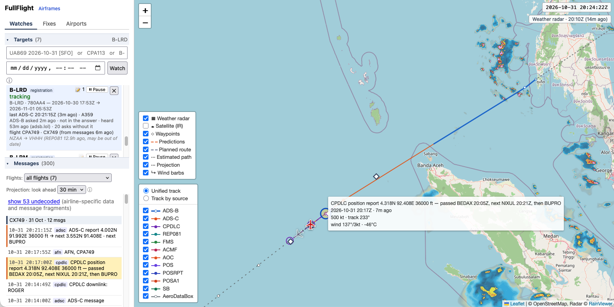

# FullFlight

Self-hosted tracker that follows specific aircraft by combining live ADS-B positions (adsb.lol, adsb.fi) with
ACARS/ADS-C/CPDLC datalink messages (airframes.io), decoded with [golibacars](https://github.com/avanha/golibacars), a Go
port of [libacars](https://github.com/szpajder/libacars). One map, one track per flight, with the messages beside it.

**[Home page](https://avanha.github.io/FullFlight/)** · **[Details of every feature](docs/details.md)** ·
[Design notes](HANDOFF.md) · [airframes.io API findings](docs/airframes-api.md)

Each point below is a summary; follow its link for the full rules.

## Build and run

FullFlight is a pure Go program: SQLite through `modernc.org/sqlite`, no C compiler or system libraries, and it
cross-compiles (`GOOS=linux GOARCH=arm64 go build ./cmd/...`).

- **Go** 1.27.3 or newer (see `go.mod`) from <https://go.dev/dl/>. Optional: `git` (names the release in the User-Agent),
  `nodejs` for the page script tests, `sqlite3` to look inside the database.

Then:

    go test ./...
    go build -o bin/ ./cmd/...           # -> bin/fullflight
    cp config.example.yaml config.yaml   # edit; then:
    bin/fullflight -config config.yaml

## Features

### Watching aircraft

- **Watchlist.** Add a flight (`UA869 2026-10-31`, `CPA113`), a registration (`B-LRM`, `N575UP`) or a hex code; the page says
  how it read each entry. US, Canadian and Australian registrations convert to a hex with no lookup.
  [Details](docs/details.md#watchlist)
- **Destination and landing.** With a destination the watch ends when the aircraft lands there; without one it ends after a
  long stop or a new callsign. A shorter stop is a stopover. [Details](docs/details.md#watchlist)
- **Why is there no track?** Each card says when ADS-B was last asked and what came back.
  [Details](docs/details.md#what-the-last-ads-b-ask-found)
- **Pausing.** A paused watch is not polled at all but keeps its data, and can be resumed.
  [Details](docs/details.md#pausing)
- **Flights ADS-B cannot see.** With an AeroDataBox key, or by searching airframes.io for the callsign, a flight watch can
  find its aircraft anyway. [Details](docs/details.md#finding-a-flight-ads-b-cannot-see)
- **ADS-B sources** take turns, are merged, and are polled gently; every request names FullFlight in its User-Agent.
  [Details](docs/details.md#ads-b-sources)

### Datalink messages

- **Fetched and decoded by us** from the raw text, never from airframes.io's own fields; a message heard by several stations
  is stored once. Positions from ADS-C, CPDLC, REP081 and FMS reports are placed in time and drawn in their own colours.
  [Details](docs/details.md#datalink-messages)
- **Airline satellite headers** (UPS, Delta) are taken off so the message inside reads as usual.
  [Details](docs/details.md#satellite-headers-ups-delta)
- **Messages delivered days late** are dated from the time inside them where there is one, so they do not move the aircraft.
  [Details](docs/details.md#messages-delivered-days-late)
- **Route and destination** come from the aircraft's own reports (787 ACMF, A350 REP081, airline position reports,
  departure reports); the sidebar shows what they said most often and how old it is.
  [Details](docs/details.md#destination-from-the-aircraft)
- **Current flight** is the newest flight worked out for a tail or hex watch, including the next one announced at the gate.
  [Details](docs/details.md#current-flight)
- **Airline operations messages** (Qantas, Air Canada, United, China Cargo and others) are decoded and feed the route and
  departure time. [Details](docs/details.md#airline-operations-messages)
- **Clearances.** Oceanic clearances and Qantas pre-departure clearances are decoded and drawn as their own layer.
  [Oceanic](docs/details.md#oceanic-clearances) · [Pre-departure](docs/details.md#pre-departure-clearances)
- **Flight plans and predicted winds** are decoded; the plan is drawn and the projection follows it.
  [Plans](docs/details.md#flight-plans) · [Winds](docs/details.md#predicted-winds)
- **Re-decoding.** After a decoder change, `fullflight -redecode` rebuilds stored messages from their raw text.

### Flights

- **Flights are divided by flight number.** A run of sightings of one number is a flight; a gap of six hours, or a long
  stop on the ground, splits it. [Details](docs/details.md#how-an-aircrafts-history-is-divided)
- **Route and departure** are worked out afresh each time from what the reports said and what ADS-B saw.
  [Details](docs/details.md#a-flights-route-and-departure)
- **Entering a route by hand** covers what no message gave; anything a message says wins.
  [Details](docs/details.md#entering-a-route-by-hand)
- **Flights selector.** Show the most recent flight, all of them, or any one of the last 30 days.
  [Details](docs/details.md#the-flights-selector)
- **Broken flights** are joined across a long silence when the speeds fit, and you can join or split by hand.
  [Details](docs/details.md#a-flight-that-broke-in-two)
- **Stops ADS-B never saw** are found from a climb-out near an airport; the origin it gives is marked `~`.
  [Stop never seen](docs/details.md#a-stop-ads-b-never-saw) · [Seen taking off](docs/details.md#seen-taking-off)
- **Next-flight chatter** (messages about the following flight sent mid-flight) is set aside.
  [Details](docs/details.md#next-flight-chatter)
- **Explain.** `GET /api/flights/{hex}/explain` says why each flight looks the way it does.
  [Details](docs/details.md#why-a-flight-looks-the-way-it-does)
- **The time a message counts as** is worked out once, when it is stored, and every flight rule reads that one time.
  [Details](docs/details.md#the-time-a-message-counts-as)
- **Late reports** count for the flight they happened during, not the one they arrived in.
  [Late reports](docs/details.md#reports-delivered-late) · [Why late](docs/details.md#why-late)
- **Messages tagged with another flight** (late VHF uploads) are greyed and left out of the chosen flight.
  [Details](docs/details.md#messages-tagged-with-another-flight)
- **A stale callsign at power-up** is not mistaken for the end of the last flight.
  [Details](docs/details.md#a-stale-callsign-at-power-up)
- **History loaded.** The page loads four days; older flights are fetched when chosen.
  [Details](docs/details.md#how-much-history-the-page-loads)

### The map

- **Unified track.** One line runs through every plausible position from every source, each in its own colour; the legend
  switches to a line per source. [Details](docs/details.md#web-page)
- **Labels** sit beside what they name and can be dragged; D-ATIS requests are marked and show their airports.
  [Labels](docs/details.md#labels-are-held-away-from-what-they-name) · [D-ATIS](docs/details.md#d-atis-requests)
- **Predictions.** A selected report draws the route it expects. [Details](docs/details.md#predictions)
- **Waypoints** named in CPDLC reports get coordinates from the aircraft's own ADS-C, then the navigation database, then an
  estimate. [Details](docs/details.md#waypoints-named-in-cpdlc-reports) · [Wind barbs](docs/details.md#wind-barbs)
- **Estimated path and ghost positions** bridge silences and place messages that carry no position.
  [Path](docs/details.md#estimated-path-and-ads-b-points) · [Ghost](docs/details.md#ghost-position-for-a-message-with-no-position)
- **Projection and landing.** The plane shows how old its fix is, a look-ahead is drawn along the plan, and a landing is
  inferred when an aircraft drops out of coverage near an airport.
  [Projection](docs/details.md#projection) · [Staleness](docs/details.md#how-the-plane-shows-how-stale-its-fix-is) ·
  [Landing](docs/details.md#landing)
- **Weather.** RainViewer radar and NASA GIBS infrared satellite overlays. [Details](docs/details.md#weather-radar)
- **Search.** Fixes and airports by name or code. [Fixes](docs/details.md#fix-search) · [Airports](docs/details.md#airport-search)
- **The page** folds Targets and Messages like an accordion and remembers your choices.
  [Details](docs/details.md#web-page)

### Other screens and tools

- **Airframes and notes.** Every aircraft we know of, with notes that never expire. [Details](docs/details.md#airframes-and-notes)
- **Stations.** Which receivers delivered our messages, and how late. [Details](docs/details.md#stations)
- **Backfill.** Read adsb.lol's daily archives to fill the track from before an aircraft was followed.
  [Details](docs/details.md#backfilling-a-track-from-adsblols-archive) · [When it fails](docs/details.md#when-it-does-not-work)
- **Storage and purging.** Everything is kept by default (tens of MB a month); `-stats` and `-purge-older-than` manage it.
  [Details](docs/details.md#storage-and-purging)

## Status

Done: the watchlist, the ADS-B poller with source fallback, the SQLite track log, the message fetcher and decoder, the web
page, waypoints learned from messages, the division of an aircraft's history into flights, flight plans, predictions and the
projection, estimated paths, weather overlays, wind barbs, the unified track, airframe notes, and fix and airport search.

Not yet:

- The contents of the A350 engine, fuel and parameter reports (only their headers are read), the compressed engine files
  (`EXW…`), and putting continuation blocks of a MIAM message back together.
- Comparing an ADS-C report's predicted ETA with the actual passage of the waypoint, and showing the error.
- Live updates pushed to the page (it polls; SSE would replace that).
- Deployment docs: a systemd unit and a reverse proxy example. (HTTP basic auth is built in; see `config.example.yaml`.)
